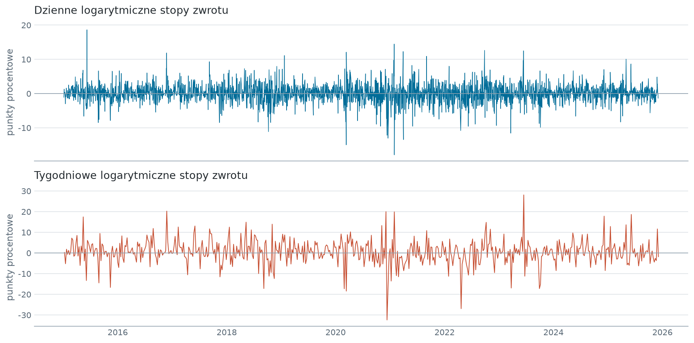
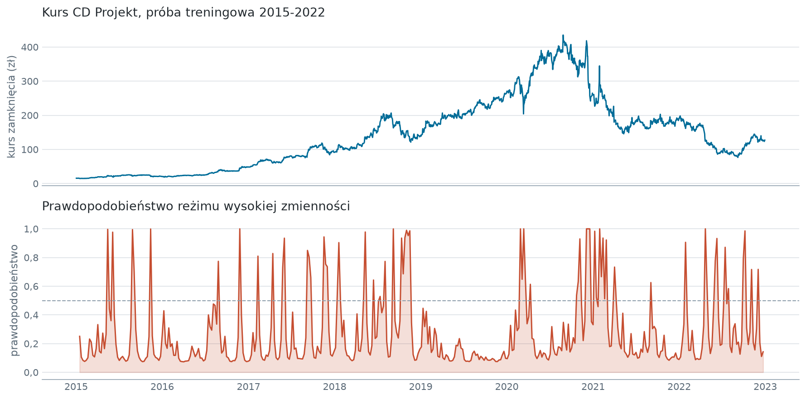
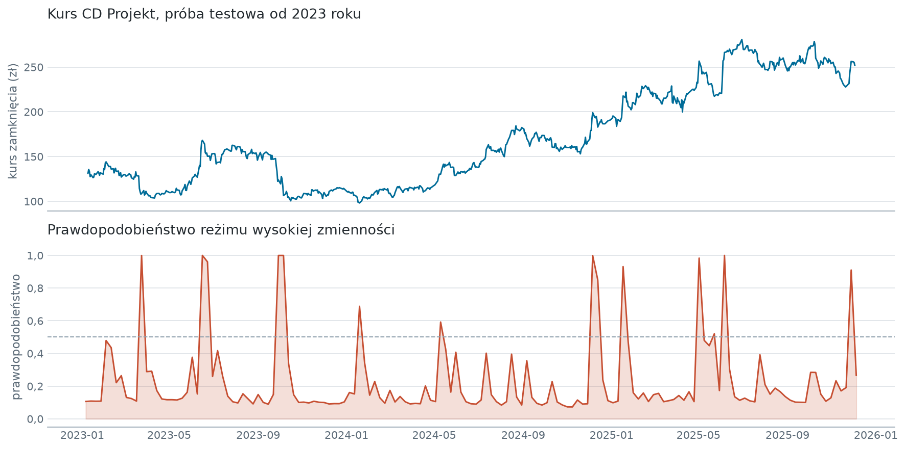
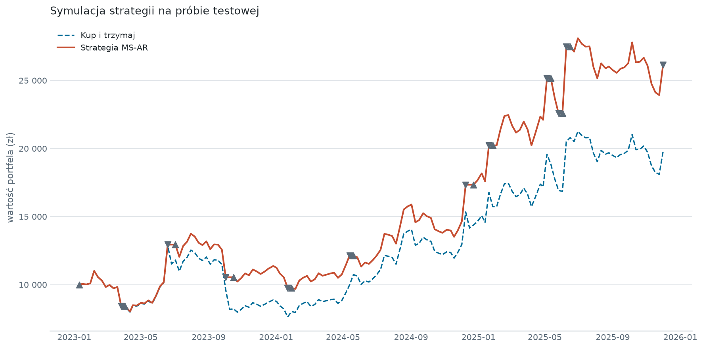

# Reżimy zmienności a strategia inwestycyjna na akcjach CD Projekt

[](https://github.com/yaczanga/ms-ar-cdprojekt/actions/workflows/testy.yml)

Autoregresyjny model przełącznikowy Markowa rozpoznaje na tygodniowych stopach zwrotu dwa stany rynku i na tej podstawie decyduje o wejściu i wyjściu z pozycji. Na próbie testowej obejmującej 153 tygodnie strategia kończy z kapitałem 26 147,30 zł wobec 19 782,00 zł dla pasywnego kup-i-trzymaj. Symulacja nie uwzględnia kosztów transakcyjnych, a przy 22 transakcjach jest to ograniczenie, które przesądza o praktycznej wartości wyniku - prowizja 0,39% zjada około jednej trzeciej przewagi.

## Pytanie badawcze

Czy statystyczna detekcja reżimu wysokiej zmienności pozwala wyjść z rynku przed spadkiem i dzięki temu pobić strategię pasywną na pojedynczej, mocno zmiennej spółce. Podejście przenosi na pojedynczy walor pomysł Kritzmana, Page'a i Turkingtona (2012), którzy modelem przełącznikowym sterowali alokacją całego portfela na podstawie zmiennych makroekonomicznych.

## Dane

Dzienne notowania CD Projekt S.A. ze stooq.pl: 2733 obserwacje od 2015-01-02 do 2025-12-03, zagregowane do 571 tygodni kończących się w piątek, co daje 570 tygodniowych stóp zwrotu. Plik `data/raw/cdr_d.csv` waży 160 kB i leży w repozytorium, więc projekt odtwarza się bez pobierania czegokolwiek.

Podział wyznacza data 2023-01-01: 416 tygodni treningowych i 153 tygodnie testowe; tydzień graniczny odpada, żeby żadna obserwacja nie trafiła do obu zbiorów. Agregacja tygodniowa wygładza wahania płynności, które nie niosą informacji o kondycji spółki, i wyostrza różnicę wariancji między reżimami - na danych dziennych jest ona wyraźnie mniejsza.



Amplituda stóp tygodniowych jest wyższa, i to właśnie ona pozwala modelowi rozdzielić stany.

## Metody

Model to MS-AR z dwoma reżimami i składnikiem autoregresyjnym rzędu pierwszego, ze stałą i wariancją zależnymi od stanu, estymowany metodą największej wiarygodności. Logarytmiczne stopy zwrotu przeskalowano stukrotnie, więc wariancje wyrażone są w punktach procentowych.

Stacjonarność szeregu sprawdzono testem Dickeya-Fullera na danych tygodniowych, bo to one wchodzą do modelu. Logarytm cen daje statystykę -2,373 przy p równym 0,150, a pierwsze różnice -14,577 przy p poniżej 0,001 - szereg stóp zwrotu jest stacjonarny, co jest warunkiem koniecznym estymacji.

Reżimów nie rozpoznaje się po numerze stanu, bo numeracja w modelu jest dowolna - rozstrzyga oszacowana wariancja składnika losowego. Bez tego etykiety potrafią zamienić się miejscami między kolejnymi estymacjami.

Decyzję podejmuje procedura rozszerzającego się okna: w każdym z 153 tygodni próby testowej model estymowany jest od nowa, wyłącznie na danych dostępnych do tego tygodnia. Sygnał opiera się na prawdopodobieństwie filtrowanym, nie wygładzonym - wygładzone korzysta z całej próby i wprowadziłoby do decyzji informację z przyszłości.

Zlecenie realizowane jest po cenie otwarcia pierwszej sesji po dniu sygnału, a nie po cenie z dnia sygnału. Przy progu 0,5 prawdopodobieństwa reżimu niskiej zmienności strategia jest w rynku, poniżej - w gotówce.

Estymacja przeszukuje losowe punkty startowe, więc generator losowy przekazywany jest jawnie przez `rng`. Bez tego dwa przebiegi tego samego kodu dają oszacowania różniące się na drugim miejscu po przecinku.

## Kluczowe wyniki

Na próbie treningowej model rozdziela stany o wariancjach 14,32 i 91,48. Okresy wysokiego prawdopodobieństwa pokrywają się z załamaniem rynków na początku 2020 roku i z premierą Cyberpunka 2077 na przełomie 2020 i 2021.



W ostatnim oknie próby testowej wariancja reżimu niskiej zmienności wynosi 11,60, a wysokiej 88,30 - prawie ośmiokrotnie więcej. Macierz przejścia pokazuje, że stan spokojny jest trwalszy niż nerwowy:

| | Do: niska zmienność | Do: wysoka zmienność |
|---|---|---|
| Z: niska zmienność | 79,48% | 20,52% |
| Z: wysoka zmienność | 48,41% | 51,59% |

Model wskazał stan wysokiego ryzyka w 9,15% tygodni próby testowej, czyli w 14 na 153. Przy spółce tak zmiennej jak CD Projekt standardowy próg decyzyjny daje więc model selektywny, który wychodzi z rynku rzadko.



Symulacja zaczyna się kapitałem 10 000 zł i kończy wynikiem 26 147,30 zł wobec 19 782,00 zł dla kup-i-trzymaj, czyli 161,47% wobec 97,82%. Do 2023-10-16 strategia zbudowała 2 316,60 zł przewagi, czyli ponad jedną trzecią wyniku końcowego, wychodząc z rynku przed korektą drugiej połowy 2023 roku.



## Ograniczenia

- **Brak kosztów transakcyjnych.** `COMMISSION` wynosi 0, a strategia wykonuje 22 transakcje. Przy prowizji 0,39% od każdej strony kapitał końcowy spada do 23 997,40 zł przy benchmarku 19 705,15 zł, więc przewaga maleje z 6 365,30 zł do 4 292,25 zł. Wynik nadwyżkowy jest realny, ale nie w podanej wysokości. Wariant przelicza się zmianą `COMMISSION` w `src/config.py`.
- **Jeden walor i jeden okres.** Wniosek dotyczy CD Projekt w latach 2023-2025. Nie przenosi się automatycznie na inne spółki ani na inny stan rynku.
- **Brak optymalizacji progu.** Próg 0,5 przyjęto bez strojenia. To chroni przed przeuczeniem, ale nie daje podstaw do twierdzenia, że jest najlepszy.
- **Model nie ma zmiennych egzogenicznych.** Przyjęto, że zdarzenia wpływające na wycenę odbijają się w samym kursie.
- **Brak zbieżności w pojedynczym kroku nie przerywa symulacji.** Taki tydzień dostaje prawdopodobieństwo równe progowi i w efekcie sygnał wyjścia z rynku. W tym przebiegu nie wystąpił ani raz.

## Struktura projektu

```
ms-ar-cdprojekt/
├── data/raw/cdr_d.csv              notowania dzienne, jedyne wejscie
├── notebooks/
│   └── 01_ms_ar_cdprojekt.ipynb    sterownik: wywoluje src/, zapisuje outputs/
├── src/
│   ├── config.py                   sciezki i parametry, jedyne miejsce ze stalymi
│   ├── data_load.py                wczytanie, agregacja tygodniowa, test ADF
│   ├── regimes.py                  estymacja MS-AR, macierz przejscia, sygnaly
│   ├── backtest.py                 symulacja, benchmark, dziennik transakcji
│   ├── viz.py                      rysunki
│   └── plot_style.py               paleta i proporcje, jedyne zrodlo barw
├── outputs/figures/                cztery rysunki osadzone wyzej
├── outputs/tables/                 tabela ADF, macierz przejscia, sygnaly, transakcje
└── tests/test_methodology.py       gwarancje metodologiczne
```

Notebook jest jedynym wejściem do obliczeń. Logika liczbowa mieszka w `src/`, komórki tylko ją wywołują.

## Uruchomienie

```bash
python -m venv venv
```

```bash
venv\Scripts\pip install -r requirements.txt
```

Następnie otwórz `notebooks/01_ms_ar_cdprojekt.ipynb` i wykonaj wszystkie komórki od góry. Pełny przebieg trwa około minuty na zwykłym laptopie; kosztowna jest wyłącznie pętla rozszerzającego się okna, która estymuje model 153 razy po około 0,4 sekundy. Rysunki i tabele zapisują się do `outputs/`.

## Testy

```bash
venv\Scripts\python -m pytest
```

Sześć testów pilnuje założeń, na których opiera się wniosek, a nie tego, czy kod się wykonuje: okno estymacji kończy się dokładnie na tygodniu sygnału, zlecenie realizuje się po cenie otwarcia następnej sesji, reżim rozpoznawany jest po wariancji a nie po numerze stanu, wiersze macierzy przejścia sumują się do jedności, liczebności próby wynikają z danych, a prowizja jest zerowa. Każdy sprawdzono mutacją kodu - po wprowadzeniu błędu, przed którym ma chronić, test zawodzi.

